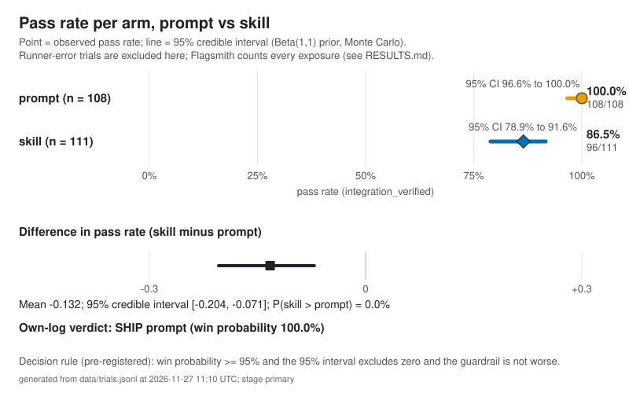
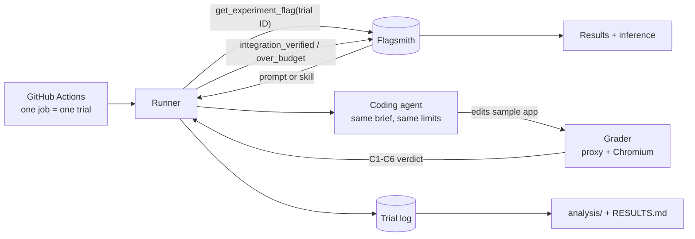
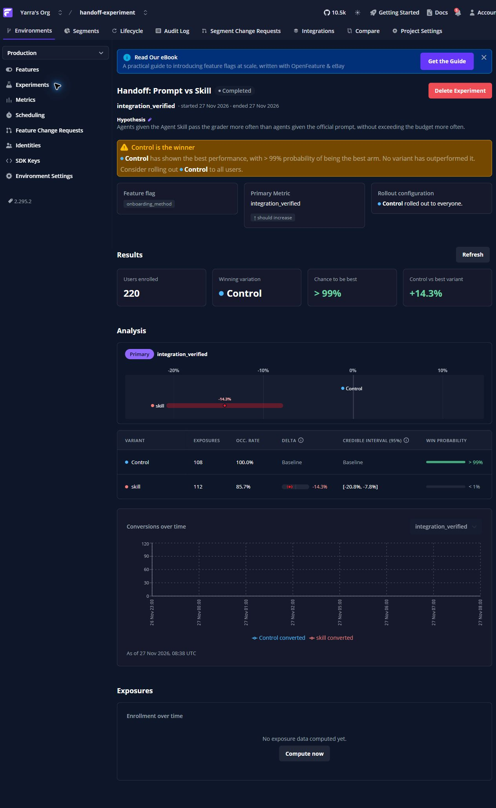
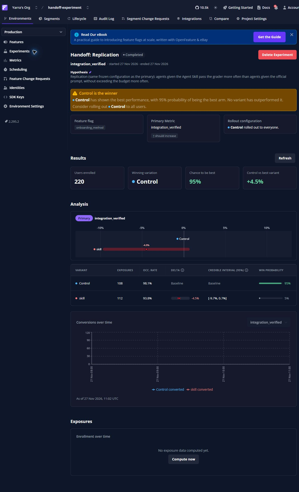

<div align="center">

# Handoff: Prompt vs Skill

### We measured it. Skill vs prompt, 220 real runs plus a 220-run replication, one pre-registered experiment, results straight from Flagsmith.

**Which gets a coding agent to a correctly wired Flagsmith A/B test more often: the official setup prompt or an Agent Skill? Now there is data.**

[](https://github.com/vivekyarra/prompt-vs-skill/actions/workflows/ci.yml)
[](https://github.com/vivekyarra/prompt-vs-skill/actions/workflows/grader.yml)
[](pyproject.toml)
[](https://flagsmith.com)
[](https://wemakedevs.org/hackathons/flagsmith)
[](LICENSE)



</div>

```bash
python -m runner --dry-run --scripted-agent-apply-reference --trial-id trial-readme-1 --out-dir out   # one full trial, no credentials
```

<p align="center"><a href="RESULTS.md"><b>Results</b></a> · <a href="EXPERIMENT.md"><b>Pre-registration</b></a> · <a href="docs/failure-labels.md"><b>Failure analysis</b></a> · <a href="docs/flagsmith-contribution.md"><b>Suggestions for Flagsmith</b></a></p>
<p align="center">Built for Toggle Wars, Track 01: Test something real</p>
<!-- VIDEO -->

---

## The problem

Every devtool now onboards AI agents, either with a prompt to paste or with a skill to install. Nobody had measured which one works. For Flagsmith, and for any devtool, that is a live product decision.

- Prompts and skills are judged on taste and anecdote today. A grader that watches real network traffic turns it into a number.
- A good answer needs the real thing: real agents, real apps, and a real Flagsmith experiment that assigns, records and decides.

Handoff runs that experiment. Flagsmith assigns each trial to the official prompt or to the skill, a ground-truth grader checks the agent's app, and Flagsmith computes the result.

## What it does

| | |
|---|---|
| **Runs a real experiment** | One flag, `onboarding_method`, assigns each trial 50/50. Flagsmith records the exposure and the grader's verdict, and computes the credible interval. |
| **Judges from network behaviour** | The grader runs the agent's app behind an intercepting proxy, drives it with Chromium and checks exposure, conversion, identity and UI from recorded traffic. |
| **Explains every failure** | All 18 graded failures are root-caused from their diffs. A blind review of 24 passing diffs found no false pass. |
| **Proposes skill v2 (untested)** | The failure analysis turns directly into proposed fixes, and skill v2 encodes them. It has not been run as an experiment arm. |
| **Checks your own app** | The same grader is a standalone 60-second wiring check for any web app. |

## See it work

Credential-free, real output: the grader on a correct reference app and on a copy that sends the conversion on page load (`python scripts/demo_grader.py`).

```text
=== reference node: PASS ===
  C1 App runs                               pass  app healthy, existing test passed, Join button clickable
  C2 Exposure sent                          pass  2 exposure event(s) for 'onboarding_demo' with V1 identity
  C3 Conversion on action                   pass  1 join_clicked event(s) in click phase, none on load
  C4 Identity match                         pass  exposure and conversion use the same identity
  C5 Identity stable                        pass  identity stable across reload; V2 differs
  C6 Flag drives the UI                     pass  button text equals the value Flagsmith returned (V1 and V2)
  C7 No server key in client (diagnostic)   pass  no server key in 2 browser-loaded assets

=== broken node/B3: FAIL ===
  C3 Conversion on action                   FAIL  join_clicked was sent during page load, before any click (1 event(s))
```

The quickstart command above runs a full trial end to end: a scripted agent applies the reference integration, the real grader passes it, and `trial_record.json` lists `integration_verified` as the only event.

## How it works



1. **Assign.** The runner reads `onboarding_method` for the trial ID. The read records the exposure.
2. **Hand off.** Variant A gets the official prompt unedited. Variant B gets the Agent Skill installed in the agent's skill folder. Both get the same task brief.
3. **Run.** The agent (OpenCode with `MiniMaxAI/MiniMax-M3.1-Flash`) edits a randomly chosen React, Node or Python sample app, with fixed turn and token limits.
4. **Grade.** The grader checks C1 to C6 from recorded traffic: the app runs, an exposure is sent, the conversion fires on click, both use one identity, the identity is stable, and the flag value drives the UI.
5. **Report.** The runner sends `integration_verified` and `over_budget` to Flagsmith, then writes the trial record.
6. **Analyse.** Flagsmith's inference is the primary result. `analysis/` cross-checks it against our own log.

## Results

The official prompt currently gets agents to a correctly wired experiment more often than a skill written without it. Flagsmith's own inference reports it, our log matches Flagsmith's counts exactly, and the failure analysis shows how to close the gap.

| `integration_verified` (Flagsmith experiment) | Official prompt | Agent Skill (v1) | Flagsmith lift, credible interval |
|---|---|---|---|
| **Primary** (220 trials, experiment 728) | **108/108 (100%)** | 96/112 (85.7%) | -14.3%, [-0.208, -0.078] |
| **Replication** (220 trials, experiment 1142) | 106/108 (98.1%) | 105/112 (93.8%) | -4.5%, [-0.097, +0.007] |
| Guardrail `over_budget`, primary / replication | 1 / 0 | 1 / 0 | |

> **Correction footnote: three primary verdicts were corrected after a grader bug fix.** The trials are `trial-45914099371-14` (skill, python), `trial-45914099371-7` (skill, python) and `trial-45914099371-30` (prompt, node). All three were originally graded as C1 failures: the app's existing test ran without the placeholder credential variables the grader supplies at app start. The fix is one-directional (the test runs clean first and is retried with the placeholders only if it failed), so no earlier pass could change. Each trial was replayed 3 of 3 with the final grader. All three flips are fail to pass (two skill, one prompt); none went from pass to fail. The three `integration_verified` events were then sent to Flagsmith with `ops/backfill_events.py` (late events were verified to be counted), so Flagsmith's counts include them. Both views:
>
> | Primary view | Official prompt | Agent Skill (v1) |
> |---|---|---|
> | As originally graded | 107/108 (99.1%) | 94/112 (83.9%) |
> | As corrected (= Flagsmith's counts, the table above) | 108/108 (100%) | 96/112 (85.7%) |
>
> The per-arm rates for the first 40 trials were already visible when the correction was decided (as graded: prompt 19/20, skill 15/20). Details: [EXPERIMENT.md](EXPERIMENT.md) and the post-freeze corrections section of [RESULTS.md](RESULTS.md).

**Flagsmith's own results pages.** Flagsmith results page, experiment 728 (primary): dated screenshot to be added at `assets/flagsmith-results-728.png`; the raw results read it shows is committed as `data/flagsmith_primary_results.json` (as_of 2026-11-27T08:38:18.776351Z). <!--  -->

Flagsmith results page, experiment 1142 (replication): dated screenshot to be added at `assets/flagsmith-results-1142.png`; the raw results read it shows is committed as `data/flagsmith_replication_results.json` (as_of 2026-11-27T11:02:42.683924Z). <!--  -->

Primary: Flagsmith reports a lift of -14.3% for the skill, a credible interval of [-0.208, -0.078] on the absolute difference, and a skill chance to win of about 0.0009%. The decision rule fixed before the first trial (win probability at least 95%, interval excludes zero, guardrail not worse) is met by the prompt arm.

<!-- REPLICATION:START -->
We ran the whole experiment a second time, as its own Flagsmith experiment with the same frozen setup: the prompt reached 106 of 108 (98.1%) and the skill 105 of 112 (93.8%). Flagsmith reports a lift of -4.5% for the skill, a credible interval of [-0.097, +0.007] that includes zero, and a skill chance to win of about 4.6%. The replication points the same way with a smaller gap, and by the same rule it is inconclusive on its own, so the pre-registered decision rests on the primary alone. Flagsmith's counts match our log exactly in both runs, there were zero runner errors, and the skill was loaded in 112 of 112 skill trials and 0 of 108 prompt trials. Both runs are in [RESULTS.md](RESULTS.md).
<!-- REPLICATION:END -->

**Round 04: the winner ships through the same flag.** On 2026-11-27 the replication experiment was completed in Flagsmith with rollout decision `control` (the official prompt, the primary's winner), and a check of 5 fresh identities all returned `prompt`; 5 confirmation trials were dispatched in rollout mode and are excluded from the analysis. All 5 confirmation trials (stage `rollout`, no events sent) were served `prompt` and passed the wiring check.

What the 18 root-caused failures show:

| Cause | Skill | Prompt |
|---|---|---|
| Browser SDK entry or unbound `fetch` loses events (React) | 10 | 0 |
| Local evaluation against the grader emulator (Node) | 4 | 0 |
| Test needed credentials at import (graded C1 fail, corrected to pass) | 2 | 1 |
| Reload served from an in-process cache the agent added (Node) | 1 | 0 |

In the React failures the page and button were right and only event delivery was lost. The prompt sends the agent to a docs page that shows the correct browser import, and the skill had no import path. Skill v2 adds the exact import per runtime, one targeted docs read, and verification in the runtime that sends the events. Details: [RESULTS.md](RESULTS.md), [failure labels](docs/failure-labels.md), [blind audit](docs/blind-audit.md).

## Proposed skill v2 (untested)

Skill v2 ([`skill/flagsmith-ab-test-v2/`](skill/flagsmith-ab-test-v2/SKILL.md)) is a proposal: fixes drawn from the failure analysis, written after the primary results. **All of v2 is untested.** It was never run as an experiment arm (the declared follow-up was not started because the spending cap was reached, see [EXPERIMENT.md](EXPERIMENT.md)), and its results and ship steps (read results, decision rule, approval gate, rollout, verify) were never run against live Flagsmith by an agent following the skill. What it proposes:

1. Create the multivariate flag with a keyed variation, the conversion metric and the experiment, then start it.
2. Wire the right SDK for the runtime, with the exact import per runtime, and identify the visitor once.
3. Verify in the real runtime that sends the events, not in a side script.
4. Read the results with `--json --jq`, apply the agreed decision rule, ask a human before any production change, then ship the winner through the same flag and verify it with fresh identities.

v1 is what was measured. Every result in this README is for v1 and the official prompt.

## How Handoff uses Flagsmith

| Flagsmith feature | What Handoff does with it |
|---|---|
| Multivariate flag with a keyed variation | `onboarding_method`: `prompt` / `skill`, 50/50 |
| Experiment-flag read that records the exposure | The runner reads the flag with the trial ID before the agent starts |
| `trackEvent` conversions | `integration_verified` and `over_budget` per trial, with the same identity |
| Two metrics | Primary `integration_verified`, guardrail `over_budget` |
| Experiment with results and inference | Credible interval and chance to win from Flagsmith, cross-checked against our log |
| Second experiment on the same flag | The replication runs as its own experiment |
| End an experiment and roll out the winner | The replication experiment was completed with rollout decision `control` (the prompt), and fresh identities return it from the same flag |
| CLI and skills | The skill drives the whole setup through the `flagsmith` CLI and the SDKs |

Flagsmith is the experiment engine here, not a logging side channel. Every feature and the file that uses it: [docs/how-handoff-uses-flagsmith.md](docs/how-handoff-uses-flagsmith.md).

## Check your own app in 60 seconds

The grader is a standalone tool. It answers "does my Flagsmith experiment wiring record exposures and conversions?" for any web app, with no Flagsmith credentials and no traffic to the real service.

```bash
pip install playwright==1.63.0 mitmproxy && python -m playwright install chromium
(cd path/to/your/app && npm ci)
python -m grader --app-dir path/to/your/app --stack custom --start-cmd "npm start" \
  --url http://127.0.0.1:3000/ --flag your_flag --event signup_clicked \
  --click-selector "#signup" --variant-values "Sign up,Create account" --out result.json --report
```

`--stack react|node|python` keeps the built-in install, test and start steps. `--variant-values` is "control,variation". Exit code 0 is a pass, 1 a fail, 2 a grader error. `--report` prints one fix hint per failed check.

| Check | Means |
|---|---|
| C1 | the app starts (and its tests pass, on the built-in stacks) and the button can be clicked |
| C2 | an exposure event is recorded for the flag |
| C3 | the conversion is sent from the click, not on page load |
| C4 | exposure and conversion use the same visitor identity |
| C5 | the identity survives a reload and differs for a new visitor |
| C6 | the button text is the flag value Flagsmith returned |
| C7 | (diagnostic) no server key reaches the browser |

The same check runs in GitHub Actions:

```yaml
name: flagsmith-wiring
on: [push, pull_request]
jobs:
  wiring:
    runs-on: ubuntu-latest
    steps:
      - uses: actions/checkout@v4
      - uses: actions/checkout@v4
        with: { repository: vivekyarra/prompt-vs-skill, path: .grader }
      - uses: actions/setup-python@v5
        with: { python-version: "3.12" }
      - uses: actions/setup-node@v4
        with: { node-version: "22" }
      - run: pip install playwright==1.63.0 mitmproxy
      - run: python -m playwright install --with-deps chromium
      - run: npm ci
      - run: |
          PYTHONPATH=.grader python -m grader --app-dir . --stack custom --start-cmd "npm start" \
            --url http://127.0.0.1:3000/ --flag your_flag --event your_conversion_event \
            --click-selector "#your-button" --variant-values "Control text,Variation text" \
            --out result.json --report
```

The grader's local emulator reports your flag as enrolled in a running experiment, so it verifies your code and not your Flagsmith project setup. To reuse the method for your own devtool, see "Adapt it to your devtool" in [docs/grader.md](docs/grader.md).

## Quick start

```bash
pip install playwright==1.63.0 mitmproxy requests flagsmith flask pytest pyyaml ruff
python -m playwright install chromium          # also needs Node 22
python -m runner --dry-run --scripted-agent-apply-reference --trial-id trial-readme-1 --out-dir out
pytest runner/tests tests analysis -q          # unit tests
python analysis/analyze.py --trials data/trials.jsonl \
    --flagsmith-json data/flagsmith_primary_results.json --out RESULTS.md   # regenerate results and figures
```

To run the whole experiment from GitHub Actions (preflight, ops, trials, collect, analyze) and for the environment variable names, see [docs/setup.md](docs/setup.md).

## Engineering

- **Pre-registered.** Question, metrics, decision rule, sample size and stopping rule were committed before the first production trial, in the freeze commit [`c74e237`](https://github.com/vivekyarra/prompt-vs-skill/commit/c74e23729987dd8d5b27c8ab2969cac6e2849fcc) (merged 2026-11-26T23:39:33Z, 1 minute 19 seconds before the first production trial record at 23:40:52Z; a git tag could not be created from our environment, so the commit link is the pointer). Every deviation and correction is logged in [EXPERIMENT.md](EXPERIMENT.md), and its "Amendments after the freeze" index lists every later edit: none changed the hypothesis, the metrics or the decision rule.
- **One variable.** Same agent, model, limits, task brief, sample apps and grader for both arms. Only the handoff differs ([fairness](docs/fairness.md)).
- **A grader that is itself tested.** One reference app per stack passes every check, and one broken copy per check fails exactly that check, in two interception modes.
- **Two sources of truth that agree.** Flagsmith's counts and our own trial log match exactly, per arm.
- **Audited passes.** A blind review of 24 passing diffs, arm hidden, found 24 real passes and 0 false passes.
- **Isolated credentials.** The experiment project is touched only by the runner. Agents work in a separate sandbox project, and `scripts/secret_scan.py` runs in CI.
- **Reproducible.** One command runs a full trial without credentials. CI runs lint, unit tests, the grader self-tests and an end-to-end trial.

**Scope.** What is measured:

- one agent harness and model (OpenCode 1.19.6 with `MiniMaxAI/MiniMax-M3.1-Flash`);
- small sample apps in React, Node and Python;
- the grader checks wiring from network behaviour against a local Flagsmith emulator, so `integration_verified` means the agent's code is wired correctly and does not cover the Flagsmith-side setup;
- the sample is 220 trials, below the original per-variant target, because of a spending cap (a logged deviation).

## Tech stack

| Layer | Choice |
|---|---|
| Orchestration | Python 3.12, GitHub Actions matrix |
| Experiment engine | Flagsmith Cloud (flag, metrics, experiment, results), Flagsmith Python SDK, Flagsmith CLI |
| Agent | OpenCode 1.19.6, `MiniMaxAI/MiniMax-M3.1-Flash` on Nebius Token Factory |
| Grader | Playwright (Chromium), mitmproxy, a local Flagsmith emulator |
| Sample apps | React (Vite), Node (Express), Python (Flask) |
| Analysis | Python standard library, Beta-Binomial cross-check, SVG figures |

## Project structure

```text
runner/      one-trial orchestrator (assign, run agent, grade, report)
grader/      Playwright + mitmproxy judge and local Flagsmith emulator, with self-tests
skill/       Agent Skill: flagsmith-ab-test (v1, frozen) and flagsmith-ab-test-v2
prompt/      the official Flagsmith setup prompt, unmodified
brief/       task brief shared by both variants
apps/        sample apps, reference solutions, broken fixtures
analysis/    trial-log analysis, Flagsmith cross-check, figures
data/        trial records, Flagsmith results snapshot, result notes
ops/         Flagsmith setup, snapshot, rollover and rollout scripts
scripts/     demo grader, preflight, secret scan
assets/      results and failure figures, video cards
docs/        architecture, Flagsmith usage, setup, grader, fairness, audits
tests/       repo-level checks (workflows, skill, scaffold)
EXPERIMENT.md  pre-registration, freeze log, deviations      RESULTS.md  generated results
```

## Docs

- [Architecture](docs/architecture.md) and [How Handoff uses Flagsmith](docs/how-handoff-uses-flagsmith.md)
- [Setup](docs/setup.md), [Grader](docs/grader.md) and [Fairness](docs/fairness.md)
- [Failure labels](docs/failure-labels.md), [Blind audit](docs/blind-audit.md) and [SDK notes](docs/flagsmith-sdk-notes.md)
- [Suggestions for Flagsmith](docs/flagsmith-contribution.md) and [Video script](docs/video-script.md)

## Built by

[Vivek Yarra](https://github.com/vivekyarra) for **Toggle Wars: The Flagsmith Experimentation Hackathon** (WeMakeDevs × Flagsmith), Track 01: Test something real. MIT licensed.
