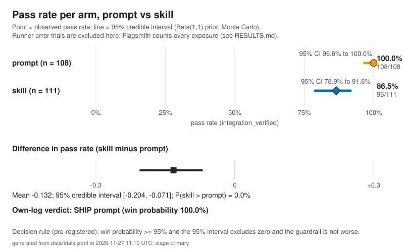
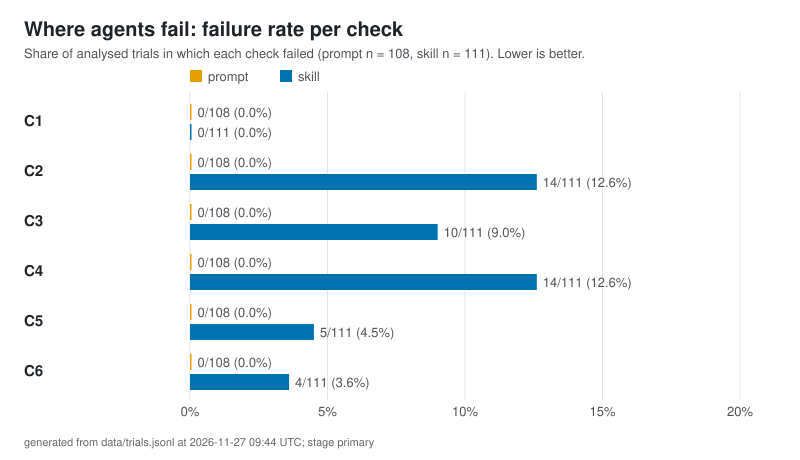
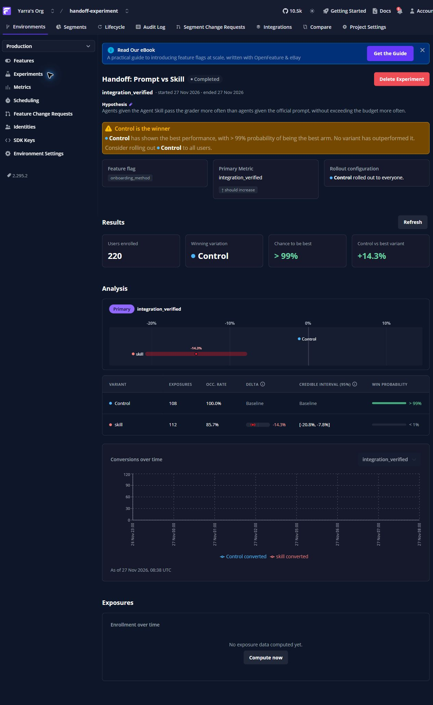
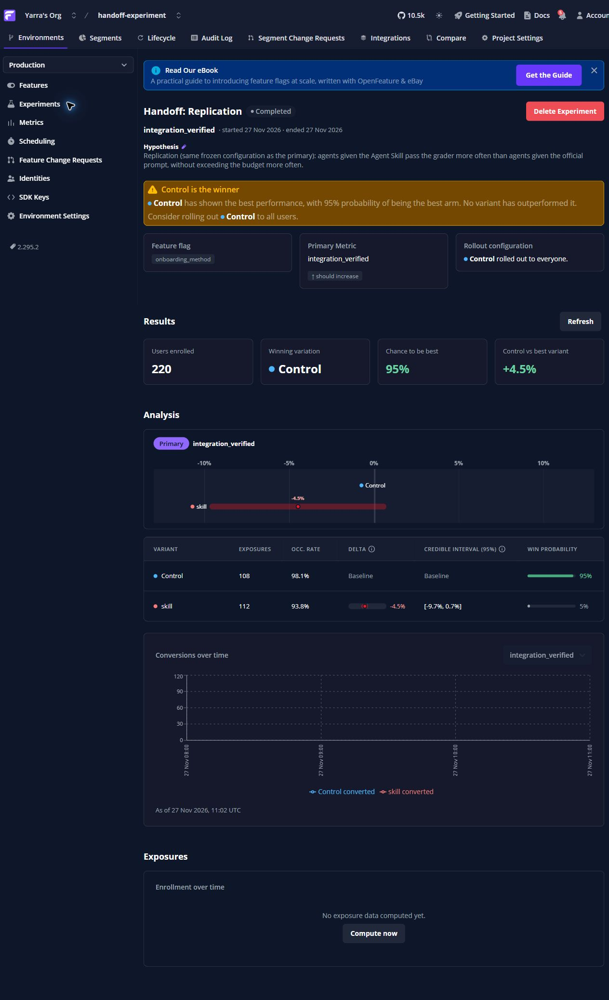

# RESULTS

**Stage analysed:** `primary` (the pre-registered experiment; the decision uses this stage alone).

_Generated by `analysis/analyze.py` at 2026-11-27 12:29 UTC from `data/trials.jsonl` (220 records). Every number below is computed from that log, except the Flagsmith section, which is supplied separately._

## 1. Primary result (from Flagsmith)

| Field | Value |
|---|---|
| Exposures per variant | {"prompt": 108, "skill": 112} |
| `integration_verified` rate per variant | {"prompt": "108/108 = 100.0%", "skill": "96/112 = 85.7%"} |
| Guardrail `over_budget` events / exposed, per variant | {"prompt": "1/108", "skill": "1/112"} |
| Lift | -14.3% (skill relative to prompt) |
| Credible interval on the difference | [-0.208, -0.078] on the absolute difference (skill - prompt) |
| Win probability | skill 0.000850%; prompt 99.999150% |
| Screenshot | Flagsmith results page, experiment 728: dated screenshot to be added at `assets/flagsmith-results-728.png`; the raw results read it shows is committed as `data/flagsmith_primary_results.json` (as_of 2026-11-27T08:38:18.776351Z) <!--  --> |
| Dashboard read at (UTC) | 2026-11-27T08:38:18.776351Z |

### Our own-log cross-check (NOT Flagsmith's statistics)

Computed by us from `data/trials.jsonl` with a Beta(1,1)-prior Beta-Binomial model, 100,000 Monte Carlo draws, seed 20261129. Runner-error trials are excluded from the denominators. This is a sanity check on Flagsmith's numbers, not a replacement for them.

| Variant | Trials analysed | `integration_verified` | Pass rate |
|---|---|---|---|
| prompt | 108 | 108 | 100.0% |
| skill | 111 | 96 | 86.5% |

- P(skill > prompt): 0.0%
- 95% credible interval on difference (skill - prompt): [-0.204, -0.071] (mean -0.132)

## 2. Decision

Rule, as pre-registered in `EXPERIMENT.md`: ship the winner only if win probability >= 95% AND the 95% credible interval on the difference excludes zero AND the guardrail is not significantly worse for it. Otherwise inconclusive. The official decision uses Flagsmith's numbers; the line below applies the same rule to our own-log cross-check.

- **Own-log outcome: SHIP `prompt`** (win probability 100.0%).

## 3. Guardrail and cost

| Variant | `over_budget` | Rate | Mean turns | Mean tokens | Mean cost (USD) | Mean duration (s) |
|---|---|---|---|---|---|---|
| prompt | 1/108 | 0.9% | 84.9 | 4503172 | 0.101 | 499 |
| skill | 1/111 | 0.9% | 64.8 | 2789320 | 0.082 | 358 |

Own-log P(skill over_budget rate > prompt) = 48.9%; 95% interval on difference [-0.037, +0.036].

### Cost and speed (mean / median / p90)

Cells show `mean / median / p90`. Tokens are input plus output. Runner-error trials are excluded. Descriptive only; not part of the decision.

**All analysed trials**

| Arm | n | Turns | Tokens (input+output) | Cost (USD) | Duration (s) |
|---|---|---|---|---|---|
| prompt | 108 | 84.9 / 80.0 / 116.2 | 4503172 / 4134890 / 7096183 | 0.101 / 0.090 / 0.156 | 499 / 500 / 764 |
| skill | 111 | 64.8 / 58.0 / 89.0 | 2789320 / 2015030 / 5019355 | 0.082 / 0.052 / 0.163 | 358 / 207 / 720 |
| skill vs prompt | | -24% / -28% / -23% | -38% / -51% / -29% | -19% / -42% / +5% | -28% / -59% / -6% |

**Passing trials only**

| Arm | n | Turns | Tokens (input+output) | Cost (USD) | Duration (s) |
|---|---|---|---|---|---|
| prompt | 108 | 84.9 / 80.0 / 116.2 | 4503172 / 4134890 / 7096183 | 0.101 / 0.090 / 0.156 | 499 / 500 / 764 |
| skill | 96 | 62.0 / 55.5 / 85.0 | 2560939 / 1860703 / 4848702 | 0.071 / 0.049 / 0.133 | 308 / 177 / 617 |
| skill vs prompt | | -27% / -31% / -27% | -43% / -55% / -32% | -30% / -46% / -15% | -38% / -65% / -19% |

## 4. Sanity checks

- Sample ratio (our log, all exposed trials): prompt 108, skill 112 (skill share 50.9%); chi-square = 0.073, p = 0.7874. **OK** (band 45%-55%; flagged if outside the band or p < 0.001).
- Runner error rate: 1/220 = 0.5% (**under 5%**). Per variant: prompt 0, skill 1.
- Configuration tuples seen across 220 records: **2** (more than one: see the configuration notes at the end of this file).
  - agent=opencode, model=MiniMaxAI/Mi, max_turns=220, max_tokens=12000000, repo_sha=55184be6702b, skill_sha=eb5aa00e5679, grader_sha=746ccd2c5e86, prompt_sha256=506268c2ccc4, brief_sha256=9b636f48ee6f (n=180)
  - agent=opencode, model=MiniMaxAI/Mi, max_turns=220, max_tokens=12000000, repo_sha=c74e23729987, skill_sha=eb5aa00e5679, grader_sha=3858b6bb4182, prompt_sha256=506268c2ccc4, brief_sha256=9b636f48ee6f (n=40)
- Our-log vs Flagsmith count cross-check: reported in the last section when a Flagsmith export is supplied (`--flagsmith-json`); `analysis/crosscheck.py` runs the same comparison on its own.

## 5. Where agents fail

Trials where each check failed (C1-C6 are primary; any failure fails the trial).

| Check | prompt failures | prompt rate | skill failures | skill rate |
|---|---|---|---|---|
| C1 | 0 | 0.0% | 0 | 0.0% |
| C2 | 0 | 0.0% | 14 | 12.6% |
| C3 | 0 | 0.0% | 10 | 9.0% |
| C4 | 0 | 0.0% | 14 | 12.6% |
| C5 | 0 | 0.0% | 5 | 4.5% |
| C6 | 0 | 0.0% | 4 | 3.6% |

Every failed trial with its cause and the diff line that shows it: `docs/failure-labels.md`.

## 6. Breakdown by stack (EXPLORATORY - not part of the decision)

Small per-cell samples; do not draw conclusions.

| Stack | prompt pass | skill pass |
|---|---|---|
| react | 36/36 (100.0%) | 27/37 (73.0%) |
| node | 39/39 (100.0%) | 36/41 (87.8%) |
| python | 33/33 (100.0%) | 33/33 (100.0%) |

## 7. C7 diagnostic (server key exposed in client code)

Diagnostic only; C7 does not affect `integration_verified`.

| Variant | Trials with C7 failing | Rate |
|---|---|---|
| prompt | 0/108 | 0.0% |
| skill | 0/111 | 0.0% |

### Treatment fidelity (descriptive; NOT part of the decision)

Fraction of analysed trials (among records carrying the field) in which the agent loaded the `flagsmith-ab-test` skill through its skill tool. The prompt arm is expected to be ~0.

| Variant | `skill_loaded` true |
|---|---|
| prompt | unknown |
| skill | unknown |

**EXPLORATORY:** share of trials where the trial's sandbox flag was created during the trial (`flag_created_during_trial`; `unknown` where the field is missing or the creation time could not be determined). Not a pre-registered outcome.

| Variant | Flag created during trial |
|---|---|
| prompt | unknown |
| skill | unknown |

## 8. Limitations

- One agent and one model (see the configuration tuples in section 4); results may differ for other agents and models.
- Small sample apps (React, Node, Python); not real-world codebases.
- The task brief replaces interactive answers a human would give.
- Runner-error trials are excluded from pass-rate denominators (reported separately).
- Our own-log Bayesian numbers are a cross-check with our own priors, not Flagsmith's statistics.
- The stack breakdown is exploratory and underpowered.

## Post-freeze corrections (read before interpreting results)

A grader bug found after 40 production trials (the app's existing test ran without the placeholder credential variables) wrongly failed C1 for the trials below. The fix is one-directional (an earlier pass can never become a fail); each trial was replayed 3 times with the final grader and `integration_verified` was sent afterwards by `ops/backfill_events.py`. Per-arm rates were already visible when the decision to correct was made. Both views are reported:

| view | prompt passed/n | skill passed/n |
|---|---|---|
| as originally graded | 107/108 | 94/112 |
| as corrected | 108/108 | 96/112 |

Corrected trials: `trial-45914099371-7` (skill, C1), `trial-45914099371-14` (skill, C1), `trial-45914099371-30` (prompt, C1)

## Sensitivity: trials failed by a documented grader limitation

These trials failed because the agent enabled SDK local evaluation (triggered by the `ser.` prefix of the grader's placeholder server key) and the grader's local emulator does not implement the environment-document endpoint. They are counted as failures in every primary number (pre-registered rule); this table is a sensitivity check only and is not part of the decision.

| view | prompt passed/n | skill passed/n |
|---|---|---|
| primary (flagged trials counted as failures) | 108/108 | 96/112 |
| excluding 4 flagged trial(s) | 108/108 | 96/108 |

Flagged: `trial-45914099371-12` (skill, node), `trial-45925699686-4` (skill, node), `trial-45947367007-3` (skill, node), `trial-45947367007-49` (skill, node), `trial-45967755797-40` (skill, node), `trial-45967764018-22` (skill, node), `trial-45967764018-35` (skill, node), `trial-45967764018-55` (skill, node)

## Cross-check: our log vs Flagsmith's counts

| arm | our exposures | Flagsmith exposures | our conversions | Flagsmith conversions | |
|---|---|---|---|---|---|
| prompt | 108 | 108 | 108 | 108 | match |
| skill | 112 | 112 | 96 | 96 | match |

**All counts match.**

## Replication (second independent run, identical setup; reported alongside the primary, never pooled into its decision)

Declared in `EXPERIMENT.md` before it started: the same frozen configuration, run as its own Flagsmith experiment, stage `replication`. Nothing in this section changes the primary decision above.

### Replication: Flagsmith's numbers

| Field | Value |
|---|---|
| Exposures per variant | {"prompt": 108, "skill": 112} |
| `integration_verified` rate per variant | {"prompt": "106/108 = 98.1%", "skill": "105/112 = 93.8%"} |
| Guardrail `over_budget` events / exposed, per variant | {"prompt": "0/108", "skill": "0/112"} |
| Lift | -4.5% (skill relative to prompt) |
| Credible interval on the difference | [-0.097, 0.007] on the absolute difference (skill - prompt) |
| Win probability | skill 4.617939%; prompt 95.382061% |
| Screenshot | Flagsmith results page, experiment 1142: dated screenshot to be added at `assets/flagsmith-results-1142.png`; the raw results read it shows is committed as `data/flagsmith_replication_results.json` (as_of 2026-11-27T11:02:42.683924Z) <!--  --> |
| Dashboard read at (UTC) | 2026-11-27T11:02:42.683924Z |

### Replication: our own log (NOT Flagsmith's statistics)

Runner-error trials are excluded from the denominators and reported separately.

| Variant | Trials exposed | Runner errors | Trials analysed | `integration_verified` | Pass rate |
|---|---|---|---|---|---|
| prompt | 108 | 0 | 108 | 106 | 98.1% |
| skill | 112 | 0 | 112 | 105 | 93.8% |

### Replication: cross-check of our log vs Flagsmith's counts

| arm | our exposures | Flagsmith exposures | our conversions | Flagsmith conversions | |
|---|---|---|---|---|---|
| prompt | 108 | 108 | 106 | 106 | match |
| skill | 112 | 112 | 105 | 105 | match |

**All counts match.**

### Replication: sanity checks

- Sample ratio (replication log): prompt 108, skill 112 (skill share 50.9%); chi-square = 0.073, p = 0.7874. **OK**.
- Runner error rate: 0/220 = 0.0% (**under 5%**). Per variant: prompt 0, skill 0.
- Guardrail `over_budget` (limit hits): prompt 0/108, skill 0/112.

### Replication: cost and speed (mean / median / p90)

Cells show `mean / median / p90`. Tokens are input plus output. Runner-error trials are excluded. Descriptive only; not part of the decision.

**All analysed trials**

| Arm | n | Turns | Tokens (input+output) | Cost (USD) | Duration (s) |
|---|---|---|---|---|---|
| prompt | 108 | 86.6 / 80.0 / 124.3 | 4604639 / 4063634 / 7528609 | 0.104 / 0.088 / 0.168 | 483 / 470 / 714 |
| skill | 112 | 62.8 / 57.0 / 90.7 | 2752289 / 2277916 / 4789941 | 0.078 / 0.063 / 0.136 | 320 / 227 / 746 |
| skill vs prompt | | -28% / -29% / -27% | -40% / -44% / -36% | -25% / -29% / -19% | -34% / -52% / +4% |

**Passing trials only**

| Arm | n | Turns | Tokens (input+output) | Cost (USD) | Duration (s) |
|---|---|---|---|---|---|
| prompt | 106 | 86.2 / 80.0 / 118.5 | 4565256 / 4014034 / 7348590 | 0.103 / 0.088 / 0.167 | 477 / 470 / 704 |
| skill | 105 | 62.2 / 57.0 / 86.6 | 2712181 / 2249819 / 4682421 | 0.077 / 0.062 / 0.131 | 306 / 213 / 676 |
| skill vs prompt | | -28% / -29% / -27% | -41% / -44% / -36% | -26% / -30% / -22% | -36% / -55% / -4% |

### Replication: Beta-Binomial cross-check and decision rule (replication, not the decision)

- P(skill > prompt), replication: 5.7%
- 95% credible interval on difference (skill - prompt), replication: [-0.102, +0.011] (mean -0.043)
- Replication verdict (same rule, labelled replication): inconclusive. win probability 94.3% is below 95%; 95% credible interval on the difference includes zero.

### Primary vs replication

| Run | prompt passed/n | skill passed/n | difference skill - prompt (95% interval) |
|---|---|---|---|
| primary | 108/108 | 96/111 | -0.132 [-0.204, -0.071] |
| replication | 106/108 | 105/112 | -0.043 [-0.102, +0.011] |

Pooled, secondary, not the decision: prompt 214/216, skill 201/223.

## Notes on how to read these results

These notes are written by hand and appended verbatim by `analysis/analyze.py`. Every number in them comes from the tables above, `data/*.jsonl`, `docs/failure-labels.md` or `docs/blind-audit.md`.

### Headline

Flagsmith's own experiment results (read from the Production experiment "Handoff: Prompt vs Skill") and our own log agree exactly: the official prompt reached `integration_verified` in 108 of 108 trials, the Agent Skill (v1) in 96 of 112 (85.7%). Flagsmith reports a lift of -14.3% for the skill, a credible interval of [-0.208, -0.078] on the absolute difference, and a skill chance to win of about 0.0009%. The pre-registered decision rule (win probability at least 95%, interval excludes zero, guardrail not worse) is met by the prompt arm.

### Stage structure

| Stage | Trials | What it is |
|---|---|---|
| `primary` | 220 | The pre-registered experiment, one Flagsmith experiment, frozen configuration. The decision uses this stage alone. |
| `replication` | 220 | A second run with the identical frozen configuration, in its own Flagsmith experiment, reported next to the primary result and never pooled into the decision. Completed; see the replication notes below. |
| `followup` | 110 (declared in `EXPERIMENT.md`) | An exploratory comparison of skill v2 against the official prompt. Status: not run; the spending cap was reached after the replication. Skill v2 is published for a future follow-up. |

This file analyses the `primary` stage (`--stage primary`, the default). Other stages are analysed with `--stage replication` and `--stage followup`.

### Two configuration tuples

Section 4 lists two configurations among the 220 records. The first 40 trials ran on repository commit `c74e23729987` with grader `3858b6bb4182`; the remaining 180 ran on `55184be6702b` with grader `746ccd2c5e86`. The agent, model, turn and token limits, skill, official prompt and task brief are identical in both (same hashes). The only change between them is a grader fix documented in `EXPERIMENT.md` (the "grader test-environment bug"): the app's own test (C1) now gets the placeholder credential variables when it fails without them. The fix is one-directional, so no earlier pass can change. Three of the first 40 verdicts were corrected after replaying each trial three times with the final grader (`data/corrections.jsonl`; two skill, one prompt). The "Post-freeze corrections" section above reports both views, as originally graded and as corrected. The pre-registration also asks for the results with and without the first 40 trials (verdicts as corrected):

| Subset | prompt passed/n | skill passed/n |
|---|---|---|
| first 40 trials (earlier grader) | 20/20 | 17/20 |
| remaining 180 trials (final grader) | 88/88 | 79/92 |
| all 220 | 108/108 | 96/112 |

The difference has the same direction and a similar size in both subsets.

### Trials that enabled local evaluation

Four skill-arm Node trials (`data/flagged.jsonl`) enabled the SDK's local evaluation, keyed on the `ser.` prefix of the grader's placeholder server key. Local evaluation reads an environment document that the grader's local emulator does not serve, so these trials could not record an exposure under the grader. They are kept as failures in every primary number, which is the pre-registered rule. The sensitivity section above shows the skill arm at 96/108 with those four excluded; the prompt arm is 108/108 either way. Whether a real environment document would have carried the experiment enrolment is not established, so counting them as passes would be a guess.

### Blind audit of passing diffs

To check that the grader's passes are real, 24 passing diffs (12 per arm, drawn at random from the 220) were shuffled, given random ids and reviewed against C2-C6 without knowing which arm produced them. 24 of 24 were real passes and none was a false pass (`docs/blind-audit.md`).

### Failure labels

All 18 graded failures were root-caused from each trial's diff and grader result (`docs/failure-labels.md`). One further skill trial ended in a runner error and has no grader result.

| Cause | Skill | Prompt |
|---|---|---|
| Browser SDK entry or unbound `fetch` loses events (React) | 10 | 0 |
| Local evaluation against the grader emulator (Node) | 4 | 0 |
| Test needed credentials at import (graded C1 fail, corrected to pass) | 2 | 1 |
| Reload served from an in-process cache the agent added (Node) | 1 | 0 |

The 15 skill failures that remain after corrections plus the runner-error trial make up the 16 non-passing skill exposures (96 of 112). In the React failures the page and button were right and only event delivery was lost. Every one of those agents had verified its work with a Node script, which cannot show a browser-only problem. The prompt arm sends the agent to the Flagsmith docs page, which shows the correct browser import. Skill v2 encodes the resulting fixes (`docs/fairness.md`, "Skill v2").

### Replication notes

All 220 replication trials ran on repository commit `fa46bf2` with the identical frozen configuration: the same skill (`eb5aa00e5679`), grader (`746ccd2c5e86`), official prompt, task brief, turn and token limits as the primary's final 180 trials. There were no runner errors. Flagsmith's counts match our log exactly in both arms (prompt 108 exposures and 106 conversions, skill 112 and 105).

| Run | prompt passed/n | skill passed/n | Flagsmith lift | Flagsmith credible interval (absolute difference) | skill chance to win |
|---|---|---|---|---|---|
| primary (the decision) | 108/108 (100%) | 96/112 (85.7%) | -14.3% | [-0.208, -0.078] | about 0.0009% |
| replication | 106/108 (98.1%) | 105/112 (93.8%) | -4.5% | [-0.097, +0.007] | about 4.6% |

The replication points the same way with a smaller gap. Its interval includes zero, so by the same rule the replication alone is inconclusive. The pre-registered decision rests on the primary alone. Pooled, secondary and not the decision: prompt 214/216, skill 201/223 (our own-log denominators, which exclude the one primary runner error). Guardrail `over_budget` was 0 in both replication arms (1 in each arm in the primary).

Treatment fidelity in the replication: the skill was loaded through the agent's skill tool in 112 of 112 skill trials and in 0 of 108 prompt trials. The primary records do not carry the field.

Cost and effort per trial (means over analysed trials; tokens are input plus output):

| Run | Arm | Mean turns | Mean tokens | Mean cost (USD) |
|---|---|---|---|---|
| primary | prompt | 84.9 | 4503172 | 0.101 |
| primary | skill | 64.8 | 2789320 | 0.082 |
| replication | prompt | 86.6 | 4604639 | 0.104 |
| replication | skill | 62.8 | 2752289 | 0.078 |

In both runs the skill arm used fewer turns, tokens and dollars per trial than the prompt arm.

Local-evaluation trials in the replication: four skill-arm Node trials (`trial-45967755797-40`, `trial-45967764018-22`, `trial-45967764018-35`, `trial-45967764018-55`, listed in `data/flagged.jsonl`) enabled the SDK's local evaluation and could not record an exposure under the grader's local emulator. They are counted as failures in every number above, as pre-registered. Excluding them, the replication is prompt 106/108 and skill 105/108 (97.2%); without these four, the skill's remaining replication failures are two React trials and one Python trial. As in the primary, whether a real environment document would have carried the experiment enrolment is not established.

### Skill v2 and the follow-up

Skill v2 was not run as an experiment arm. The Nebius spend budget was used up by the primary and the replication, so the declared 110-trial follow-up was not started. Skill v2 encodes the fixes from the failure analysis and is published for a future follow-up; it is not measured.

### Round 04: shipping the winner through the same flag

On 2026-11-27 at about 11:05Z the replication experiment was completed in Flagsmith with rollout decision `control`, which is the official prompt and the primary's winner. A check of 5 fresh identities all returned `prompt`. Five confirmation trials were dispatched in rollout mode (stage `rollout`, no events sent, excluded from every analysis above).

### Corrections footnote

**Three primary verdicts were corrected after a grader bug fix.** The trials are `trial-45914099371-14` (skill, python), `trial-45914099371-7` (skill, python) and `trial-45914099371-30` (prompt, node), all originally C1 failures: the app's existing test ran without the placeholder credential variables. The fix is one-directional (clean run first, retry with placeholders only if it failed), so no earlier pass could change. Each trial was replayed 3 of 3. All three flips are fail to pass (two skill, one prompt); none went from pass to fail. The three `integration_verified` events were sent to Flagsmith afterwards with `ops/backfill_events.py` (late events were verified to be counted), so Flagsmith's counts include them. As originally graded: prompt 107/108, skill 94/112. As corrected, which equals Flagsmith's counts: prompt 108/108, skill 96/112. The per-arm rates of the first 40 trials were already visible when the correction was decided (as graded: prompt 19/20, skill 15/20).
