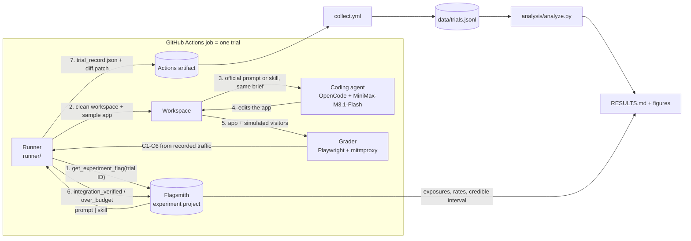

# Architecture

One job in the GitHub Actions matrix is one trial. Flagsmith assigns the variant, the grader judges the result from real network traffic, and Flagsmith receives the verdict.

## One trial



1. **Assign.** The runner reads `onboarding_method` for the identity `trial-<run_id>-<index>`. The read records the exposure.
2. **Prepare.** The runner copies a randomly chosen sample app (React, Node or Python) into a clean workspace and cleans up the trial's sandbox flag afterwards.
3. **Hand off.** Variant A gets the official prompt unedited. Variant B gets the Agent Skill installed in the agent's skill folder plus one neutral trigger line. Both get the same task brief.
4. **Run.** The agent works headless with fixed limits (220 turns, 12M tokens, 30 minutes) and sandbox credentials only.
5. **Grade.** The grader runs the app behind an intercepting proxy, drives it with Chromium and checks C1 to C6 from the recorded Flagsmith traffic (see [grader.md](grader.md)).
6. **Report.** The runner sends `integration_verified` when all checks pass and `over_budget` when a limit was hit, then flushes.
7. **Record.** The trial record and the agent's diff are uploaded as artifacts.

## After the trials

```text
trials.yml (artifacts: trial record + diff per trial)
   +-- collect.yml -> analysis/collect.py -> data/trials.jsonl
          +-- analysis/analyze.py    -> RESULTS.md, assets/results.svg, assets/failures.svg
          +-- analysis/crosscheck.py -> our counts vs Flagsmith's exposure and event counts
```

## Components

| Component | Language | Purpose |
|---|---|---|
| `apps/` | React (Vite), Node (Express), Python (Flask) | Sample apps the agents modify, plus reference and broken copies for grader self-tests |
| `grader/` | Python (Playwright + mitmproxy) | Runs an app, records Flagsmith traffic, evaluates checks |
| `skill/` | Markdown | Variant B Agent Skill (v1 frozen, v2 written after the primary results) |
| `prompt/` | Markdown | Variant A official prompt, stored unmodified |
| `brief/` | Markdown | The task brief given identically to both variants |
| `runner/` | Python | Orchestrates one trial end to end |
| `analysis/` | Python (stdlib only) | Aggregates trial logs, cross-checks Flagsmith counts, draws the figures |
| `ops/` | Python | Flagsmith setup, snapshot, rollover and rollout scripts run through `ops.yml` |
| `.github/workflows/` | YAML | Trial matrix, collection, grader tests, CI |

## Two Flagsmith projects, never mixed

- `handoff-experiment` holds `onboarding_method`, the two metrics and the experiments. Only the runner touches it.
- `handoff-sandbox` is where trial agents create their own flags. Agents never receive keys for the experiment project.

## Secrets

Names only. Values live in GitHub environment secrets and are never committed (`.env.example`, `scripts/secret_scan.py`).

| Name | Used by |
|---|---|
| `FS_EXPERIMENT_SERVER_KEY` | Runner only |
| `FS_EXPERIMENT_ADMIN_KEY`, `FS_EXPERIMENT_PROJECT_ID` | `ops/` scripts only |
| `FS_SANDBOX_CLIENT_KEY`, `FS_SANDBOX_SERVER_KEY` | Agent (SDK keys for the sandbox project) |
| `FS_SANDBOX_ADMIN_KEY`, `FS_SANDBOX_PROJECT_ID` | Agent (CLI and API) and cleanup |
| `NEBIUS_API_KEY`, `NEBIUS_BASE_URL` | Agent model endpoint |
| `ANTHROPIC_API_KEY` | Only for the optional Claude Code agent |
| `HANDOFF_*` | Agent, model, prices and limits |
